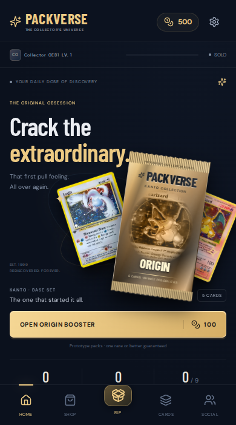

# PACKVERSE

A playable portrait card-collecting game for Aippy and the web. Buy a booster, tear its foil, reveal your cards, inspect the holographics, and build a persistent binder across nine eras.

## Run

Node 22.18+ (Node 24 recommended).

```sh
npm ci
npm run dev
npm run build
npm run preview
```

The development server uses port 8080. Production output is `dist/`. For a remotely exposed development session use `npm run dev -- --host 0.0.0.0`.

## Play

- Start with 500 coins. Nine real set pools cover Kanto through Paldea, with 1,359 card definitions.
- Standard (100 / 5 cards), Collector (250 / 7), Premium (500 / 10), Generation Bundle (900 / three standard packs), and one Daily Free Pack per UTC day have separate configured slots and guarantees. Bundles retain three individually recoverable openings.
- Home, Shop, Rip, Cards and Social remain reachable on compact portrait screens.
- Drag either direction across a booster to rip it; tap or keyboard alternatives are available.
- Purchases commit the debit, all unique card copies and opening state in one IndexedDB write transaction. Return after a reload to continue the same opening.
- Daily rewards, missions, collector levels, set milestones, rare-pull achievements and a matching minigame earn more coins. Recycle extra copies after confirming; the last copy and favourites are protected.
- The binder includes set progress, missing slots, owned/duplicate/favourite filters, number/rarity/recent sorting and search.
- The inspector provides foil, finger tilt, optional sensor tilt, high-resolution progressive images, favourites, showcases and sharing.
- Sound, music, haptics, graphics, reduced motion and diagnostics are configurable.

## Online

Game slot **game2** is fixed throughout. Join from Social to connect to the supplied Friend 3 relay. The tunnel host and room are editable there without rebuilding.

Aippy identity comes from `useUserInfo` in `@aippy/runtime/user` after loading completes. Standalone browsers use one persisted browser ID. HTTP uses the supplied direct-profile `X-Player-Profile` contract; no guest issuance or generated bearer token is involved.

Implemented: WebSocket presence, collector hello/snapshot recovery, rare-pull activity, HTTP chat with history/live deduplication, public showcase records, saved collector IDs, profile lookup and collection score leaderboards.

**Trading and marketplace transfers are unavailable.** The supplied relay cannot atomically transfer assets or authoritatively verify local ownership. The Exchange screen explains that boundary. Solo ownership and balances are device-local; published profiles and scores are client-asserted. These are visible limitations, not simulated human players or fake purchases.

Live config/schema were verified through an external fetch service: game2 uses direct-v1 profiles, 12 global slots, 20 KB relay messages, 15 events/second and the expanded storage schema. Live WebSocket exchange remains unverified: shell requests were blocked with 403 and the external browser could not execute the two-socket probe. Two independent browser contexts pass the implemented contract against a local HTTP/WebSocket fixture. Run `npm run test:live` from a network that can reach the current tunnel before relying on live service compatibility.

## Checks

```sh
npm test
npx playwright install chromium
npm run test:browser
npm run test:social
npm run test:followup
npm run test:production
npm run test:live
```

Browser suites start their own Vite and protocol test servers. `CHROMIUM_PATH` can select an existing Chromium. `PACKVERSE_SERVER` selects a live tunnel for the live-only test. Test fixtures never ship as a backend or production feature.

See [AIPPY-IMPORT.md](AIPPY-IMPORT.md), [docs/IMPLEMENTATION.md](docs/IMPLEMENTATION.md), [docs/RESEARCH.md](docs/RESEARCH.md) and [ASSET-CREDITS.md](ASSET-CREDITS.md).



Version 1.1 adds the full pack-summary loop: open another product with one transaction, jump to the binder, or share the best pull. [Current Aippy snapshot](updates/packverse-1.1.0.json).
